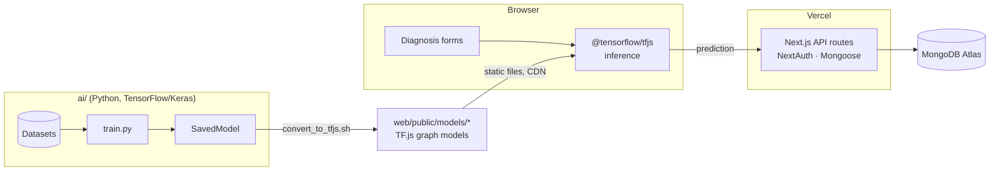

# HUB-Health 🩺

**AI-assisted diagnosis hub for doctors.** A doctor manages their patients and runs four
screening models (heart disease, breast cancer, fetal health and pneumonia on chest X-rays) whose
predictions are saved to the patient's record.

> **Live demo:** _add your Vercel URL here_ · click **"Essayer la démo"**, no account needed.
> The UI is in French.

> ⚠️ **Demo project, not a medical device.** Patients are fictional and the models were trained as a
> learning exercise. Do not use them for real diagnosis.

<!-- Add screenshots: docs/login.png, docs/patient.png -->

## Highlights

- **In-browser inference.** Keras models trained in Python are converted to TensorFlow.js and run on
  the visitor's machine. Patient measurements and X-ray images never leave the browser to get a
  prediction, and the server needs no ML runtime at all.
- **Full-stack Next.js.** Pages Router, API routes, MongoDB through Mongoose, and NextAuth
  credential sessions (JWT).
- **One-click demo.** A shared demo doctor, fictional patients seeded on first use, and a daily
  reset through Vercel Cron.
- **Chest X-ray pipeline in the browser.** The training preprocessing (PIL grayscale luma and a
  48×48 resize) is reproduced with a `<canvas>`, then fed to the CNN.

## Architecture



```
.
├── ai/                  # Training code, datasets and trained SavedModels
│   ├── heart_disease/   #   tabular, 13 features
│   ├── breast_cancer/   #   tabular, 30 features
│   ├── fetal_health/    #   tabular, 21 features (cardiotocography)
│   ├── chest_xray/      #   CNN, 48×48 grayscale X-rays
│   └── convert_to_tfjs.sh
└── web/                 # Next.js app (deployed to Vercel)
    ├── public/models/   # Converted TF.js models (~480 KB total)
    └── src/
        ├── lib/ai/      # Browser inference + preprocessing
        ├── lib/demo.ts  # Demo user, seed data, reset
        └── pages/api/   # Patients, diagnoses, auth, cron
```

## Models

| Model | Input | Architecture | Notes |
|---|---|---|---|
| Heart disease | 13 clinical values | Dense 25 → 15 → 1 | ~71 % accuracy on the full CSV |
| Breast cancer | 30 cell-nucleus measurements | Dense 45 → 20 → 1 | ~92 % accuracy on the full CSV |
| Fetal health | 21 cardiotocography features | Dense 40 → 20 → 1 | ⚠️ collapsed during training: always outputs 0.218 |
| Pneumonia | Chest X-ray image | 3× Conv2D + Dense | Dataset not in the repo (too large) |

The accuracies are measured on the whole CSV, training rows included, so they're optimistic.
**Known limitations**, worth fixing in a retraining pass: features are not standardized, the hidden
layers use `softmax` activations, and binary labels are fitted with an MSE regression head.
Standardization, a `sigmoid` output with binary cross-entropy, and a proper held-out test set would
improve all three tabular models.

The datasets are public: Heart Disease (UCI, Kaggle version), Breast Cancer Wisconsin Diagnostic
(UCI), Fetal Health Classification (Kaggle) and Chest X-Ray Images (Pneumonia) (Kaggle).

## Run locally

Requirements: Node 20+ and Docker (for MongoDB).

```bash
docker compose up -d                 # local MongoDB on :27017
cd web
cp .env.example .env.local           # then set NEXTAUTH_SECRET (openssl rand -base64 32)
npm install
npm run dev                          # http://localhost:3000 → "Essayer la démo"
```

To re-convert the models after retraining:

```bash
python3.11 -m venv .venv && .venv/bin/pip install -r ai/requirements-convert.txt
PATH=.venv/bin:$PATH ai/convert_to_tfjs.sh
```

## Deploy on Vercel (free tier)

1. Import the GitHub repository in Vercel and set **Root Directory** to `web`.
2. Add a MongoDB database from **Storage → Marketplace → MongoDB Atlas** (the free M0 cluster).
   This sets `MONGODB_URI` for you.
3. Add the environment variables `NEXTAUTH_SECRET` (`openssl rand -base64 32`) and `CRON_SECRET`
   (`openssl rand -hex 32`).
4. Deploy. The first click on "Essayer la démo" creates the demo doctor and the fictional patients.
   The cron in `web/vercel.json` resets them every day at 04:00 UTC.

| Variable | Default | Purpose |
|---|---|---|
| `MONGODB_URI` | — | MongoDB connection string |
| `NEXTAUTH_SECRET` | — | Signs session tokens (required in production) |
| `CRON_SECRET` | — | Protects `/api/cron/reset-demo` |
| `NEXT_PUBLIC_DEMO_MODE` | `true` | One-click demo login and daily reset |
| `NEXT_PUBLIC_ALLOW_REGISTRATION` | `false` | Allow creating real accounts |

## Team

Built in 2023 by a team of three:

- **Cyril de Lajudie** ([@Axoloot](https://github.com/Axoloot)): web app
- **Antoine Famibelle**: web app
- **Vincent Lemesle** ([@vincent-lemesle](https://github.com/vincent-lemesle)): AI models

Both original repositories were merged into this monorepo with their full git history.
